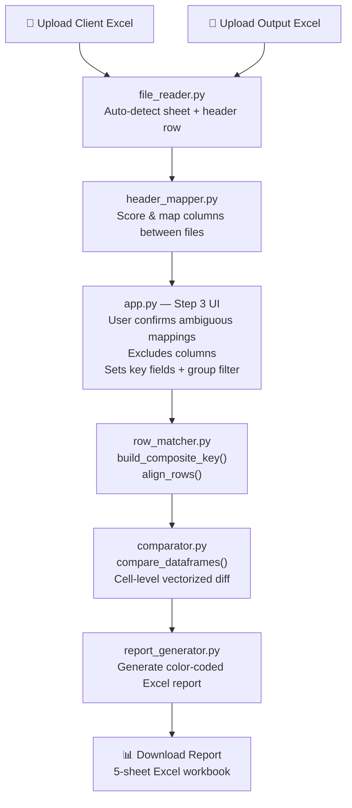

# Excel Reconciliation Tool — System Architecture

## Overview

A **Streamlit web application** that compares two Excel files cell-by-cell and produces a color-coded Excel report. It automatically detects column mappings, aligns rows using composite keys, normalizes all data types, and surfaces every difference.

---

## High-Level Pipeline



---

## Module Responsibilities

| Module | File | Purpose |
|---|---|---|
| **File Reader** | `reconciler/file_reader.py` | Read `.xlsx/.xls/.xlsb`, auto-detect best sheet & header row |
| **Header Mapper** | `reconciler/header_mapper.py` | Score & map columns between two files using 5 factors |
| **Row Matcher** | `reconciler/row_matcher.py` | Build composite keys and align rows between files |
| **Comparator** | `reconciler/comparator.py` | Cell-by-cell vectorized comparison with numeric tolerance |
| **Report Generator** | `reconciler/report_generator.py` | Write color-coded 5-sheet Excel workbook |
| **UI** | `app.py` | Streamlit front-end orchestrating all steps |

---

## Step-by-Step Data Flow

### Step 1 — File Ingestion (`file_reader.py`)

```
ExcelReadResult:
  ├── df            → cleaned DataFrame (with _excel_row_ column)
  ├── sheet_name    → auto-selected best sheet
  ├── header_row_index
  └── all_sheets
```

**Auto-detection algorithms:**

1. **Best sheet** — scores each sheet on data density + row count + column count. Highest score wins.
2. **Best header row** — scans first 15 rows; scores each as a candidate header:
   - String ratio (headers are text)
   - Uniqueness ratio (headers don't repeat)
   - Non-null ratio
   - Short value bonus (headers are brief)
3. Adds `_excel_row_` column = original 1-based Excel row number (used in report for navigation)

---

### Step 2 — Column Mapping (`header_mapper.py`)

Maps every client column to the most similar output column using **5 weighted scores**:

| Score | Weight | How it works |
|---|---|---|
| `name_score` | 40% | RapidFuzz token-sort ratio on normalized header names |
| `synonym_score` | 20% | Curated synonym groups (e.g. `qty/quantity/count/volume` all map to same group) |
| `type_score` | 15% | Inferred dtype compatibility (numeric↔numeric, date↔date, text↔text) |
| `overlap_score` | 15% | Jaccard similarity on sampled unique values (data fingerprint) |
| `unique_score` | 10% | Similarity in cardinality ratio (# unique values / total rows) |

**Thresholds:**

```
score ≥ 0.80  → AUTO_ACCEPT  (mapped automatically, shown collapsed)
score 0.50–0.80 → NEEDS_CONFIRM (shown to user as selectbox)
score < 0.50  → UNMAPPED (user must manually map in the UI)
```

**Output — `MappingResult`:**
```
MappingResult:
  ├── auto_accepted       → list[ColumnMapping]
  ├── needs_confirmation  → list[ColumnMapping]
  └── unmapped_client     → list[str]  (column names with no match)
```

---

### Step 3 — User Confirmation UI (`app.py`)

The UI presents four sub-sections in order:

#### 3a. Ambiguous Mappings
Selectboxes for columns scored 50–80%. User confirms or overrides.

#### 3b. Unmapped Columns
Columns that scored < 50% shown with a manual mapping dropdown.

#### 3c. 🚫 Exclude Columns from Comparison
Checkboxes for every confirmed mapped column. Unchecked columns are **filtered out of `confirmed`** before comparison — they still exist in the DataFrame but their cell values are never checked for differences.

#### 3d. 🔑 Row-Matching Key Fields
Three field pairs (client + output) that define how rows are aligned:

| Field | Role |
|---|---|
| **Field 1 — Primary Group** | Groups ~20,000 rows into ~180 groups (e.g. `Conc` or `Distributor`) |
| **↳ Filter by Primary Group** | Excel-style multiselect of unique values — limits comparison to selected groups only |
| **Field 2 — Secondary Sort** | Part of composite key; further narrows within each group |
| **Field 3 — Row Identifier** | Final unique discriminator within a group |

> ⚠️ If only Field 1 is set, rows are matched by alphabetical occurrence order — deletions in the middle of a group cause row-shifting. Use Field 2 or 3 for exact matching.

---

### Step 4 — Row Alignment (`row_matcher.py`)

#### Key Detection
`detect_key_fields(df)` auto-detects:
- **Grouping column** — highest cardinality ratio in a target range (groups data into ~10–500 groups)
- **ID column** — highest cardinality ratio overall (most unique per row)

#### Normalization — `_normalize_key_val(v)`
Every key value is canonicalized before building the composite key:

| Input type | Canonical output |
|---|---|
| `None`, `NaN`, `""`, `"nan"` | `"__NULL__"` |
| `bool` | `"true"` / `"false"` |
| `int`, `np.integer` | `"42"` |
| `float` whole number | `"100"` (strips `.0`) |
| `float` fractional | `"3.5"` (g-format, no trailing zeros) |
| `float` nan/inf | `"__NULL__"` / `"__INF__"` |
| `datetime`, `pd.Timestamp` | `"2024-03-15"` (ISO date, time stripped) |
| Date string (many formats) | `"2024-03-15"` |
| Numeric string `"100.0"`, `"3,500.00"` | `"100"`, `"3500"` |
| General string | lowercase + unicode NFC + collapse whitespace |

#### Composite Key Construction — `build_composite_key(df, key_cols)`

```
Step 1: Normalize each key column → temp columns _nk_{col}_
Step 2: Sort DataFrame alphabetically by normalized key columns
        (ensures occurrence #1 in client = occurrence #1 in output)
Step 3: Build _base_key_ = "val1||val2||val3"
Step 4: _occurrence_ = cumcount within each _base_key_ group (1, 2, 3…)
Step 5: _row_key_ = _base_key_ + "||#" + _occurrence_
```

Example:
```
Conc="Remedia_X", Pret=100  → _base_key_ = "remedia_x||100"
                             → _row_key_  = "remedia_x||100||#1"
```

#### Row Alignment — `align_rows()`

```python
merged = pd.merge(
    df_client.add_suffix("_client"),
    df_output.add_suffix("_output"),
    on="_row_key_",
    how="outer",
    indicator=True,
)

client_only = merged[_merge == "left_only"]   # Missing rows (in client, not output)
output_only = merged[_merge == "right_only"]  # Extra rows (in output, not client)
both        = merged[_merge == "both"]        # Matched rows → go to comparator
```

---

### Step 5 — Cell Comparison (`comparator.py`)

Fully vectorized — no Python row loops.

#### Column Type Detection
Each column pair is independently typed:
- `numeric` — > 70% of values parseable as float
- `datetime` — > 70% of values parseable as date
- `text` — everything else

#### Numeric Tolerance
```
MATCH if |client - output| ≤ max(abs_tol, rel_tol × max(|client|, |output|))

Defaults:
  abs_tol = 1e-6
  rel_tol = 1e-4  (0.01%)
```

#### Null Handling
```
both_null    → MATCH (both blank is OK)
one_null     → MISSING_CLIENT or MISSING_OUTPUT (counted in missing_cell_values)
both_present → compare by type
```

> ⚠️ `mismatched_cells` counts only value-vs-value differences.
> `missing_cell_values` counts blank-vs-value differences.
> The UI shows **both combined** as "Total Cell Differences".

#### Output — `ComparisonResult`

```
ComparisonResult:
  ├── summary          → ComparisonSummary (all counts + match %)
  ├── row_results      → list[RowResult]  (MATCH / MISMATCH / MISSING / EXTRA)
  ├── cell_diffs       → list[CellDifference]  (per-cell details)
  ├── missing_rows_df  → DataFrame  (client rows not in output)
  ├── extra_rows_df    → DataFrame  (output rows not in client)
  └── column_mappings  → list[ColumnMapping]  (passed through for report)
```

---

### Step 6 — Report Generation (`report_generator.py`)

Produces a timestamped `.xlsx` with **5 sheets**:

| Sheet | Contents | Color coding |
|---|---|---|
| **Summary** | All counts, match %, tolerances | Green/Red/Yellow |
| **Column Mapping** | All client→output mappings + confidence scores | Green (auto) / Orange (low confidence) / Red (unmapped) |
| **Row Comparison** | Every row with MATCH / MISMATCH / MISSING / EXTRA status | Green / Red / Yellow / Purple |
| **Cell Differences** | Each differing cell: row key, column, client value, output value, numeric diff, diff % | Red / Yellow by issue type |
| **Missing & Extra Rows** | Full row data for unmatched rows | Yellow (missing) / Red (extra) |

---

## UI Workflow Summary

```
Step 1  Upload two Excel files
  │
Step 2  Analyse headers → auto-map columns
  │     (background: file_reader + header_mapper)
  │
Step 3  Confirm Mappings & Key Fields
  ├── 3a Confirm ambiguous column pairs
  ├── 3b Manually map unmapped columns
  ├── 3c Exclude columns from cell comparison ← checkboxes
  └── 3d Set row-matching key fields
         ├── Field 1 (Primary Group) + Excel-style value filter
         ├── Field 2 (Secondary Sort)
         └── Field 3 (Row Identifier)
  │
Step 4  Set numeric tolerance (abs + rel)
  │
Step 5  🚀 Run Comparison
  │     (background: row_matcher + comparator)
  │
Step 6  View Results
  ├── Metric cards: Client Rows / Output Rows / Matched / Mismatched /
  │                 Missing / Extra / Cell Match % / Total Cell Diffs
  ├── Tab: Row Results
  ├── Tab: Cell Differences
  ├── Tab: ⚠️ Missing Rows (N) — in client, NOT in output
  ├── Tab: ➕ Extra Rows (N) — in output, NOT in client
  └── ⬇️ Download Excel Report
```

---

## Key Design Decisions

| Decision | Rationale |
|---|---|
| **Occurrence-based row matching** | Handles duplicate composite keys within a group without requiring a truly unique identifier |
| **Alphabetical pre-sort before cumcount** | Ensures occurrence #1 in client always corresponds to occurrence #1 in output, regardless of file row order |
| **Vectorized comparison** | NumPy/pandas operations instead of row loops — handles 20,000+ rows in < 2 seconds |
| **Separate `missing_cell_values` counter** | Blank-vs-value is semantically different from value-vs-value mismatch; tracked separately for clarity |
| **No hard-coded column names** | All mapping is score-based; system works on any business domain |
| **5-factor column scoring** | Name alone is insufficient — overlap score catches columns with different names but same data |

---

## File Structure

```
excel_comparison/
├── app.py                          ← Streamlit UI (all 6 steps)
├── launcher.py                     ← PyInstaller entry point
├── requirements.txt
└── reconciler/
    ├── __init__.py
    ├── file_reader.py              ← Sheet/header auto-detection
    ├── header_mapper.py            ← 5-factor column scoring
    ├── row_matcher.py              ← Composite key + normalization
    ├── comparator.py               ← Vectorized cell comparison
    └── report_generator.py         ← 5-sheet color-coded Excel report
```

---

## Dependencies

| Package | Purpose |
|---|---|
| `streamlit ≥ 1.35` | Web UI framework |
| `pandas ≥ 2.0` | DataFrame operations + merge |
| `numpy ≥ 1.26` | Vectorized numeric comparison |
| `openpyxl ≥ 3.1` | Read/write `.xlsx`, report formatting |
| `xlrd ≥ 2.0` | Read legacy `.xls` files |
| `pyxlsb ≥ 1.0` | Read binary `.xlsb` files |
| `rapidfuzz ≥ 3.6` | Fast fuzzy string matching for column name scoring |
